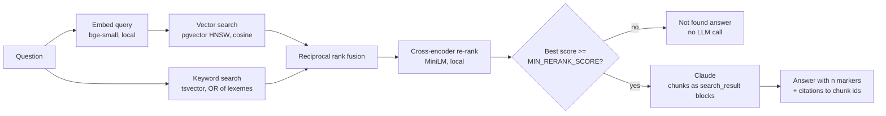

# RAG QA API

[](https://github.com/Revanth-Tatineni/rag-qa-api/actions/workflows/ci.yml)

Upload PDFs, Markdown or text, then ask questions about them. Answers come from Claude and
cite the exact chunks they used. Retrieval is hybrid (pgvector + Postgres full-text search)
with cross-encoder re-ranking, and a relevance gate answers "not found" without calling the
LLM when nothing relevant was retrieved.

The repo also measures itself: a retrieval benchmark compares three chunking strategies and
four retrieval modes on real documents (three IRS publications, 174 pages), and an answer eval
compares naive RAG with the full pipeline, using Claude as the judge.

**Stack:** FastAPI, SQLAlchemy 2 (async), PostgreSQL 16 + pgvector, Alembic, Redis, ARQ,
fastembed (ONNX embeddings and re-ranker, CPU), Anthropic SDK, pytest, Docker, GitHub Actions

## Results

RESULTS_PLACEHOLDER

## How a question is answered



1. **Hybrid retrieval.** Vector search finds paraphrases ("how old can my kid be" vs "under age
   19"), keyword search finds exact terms and numbers ("Form 8862", "$5,200") that embeddings
   blur. Both run against the same `chunks` table, so there's one database to operate.
2. **Keyword queries use OR, not AND.** A natural-language question rarely has every word in one
   chunk, so `websearch_to_tsquery` (AND) finds almost nothing. The question's stemmed,
   stopword-free lexemes are OR-ed, and `ts_rank_cd` rewards chunks that match more of them.
3. **Reciprocal rank fusion** merges the two ranked lists without having to make cosine
   similarity and `ts_rank` comparable: each chunk scores `sum(1 / (60 + rank))`.
4. **Re-ranking.** A cross-encoder reads the question and each candidate together, which is
   more accurate than comparing two independently computed embeddings, but too slow to run on
   the whole corpus. So it only re-orders the top 20.
5. **Relevance gate.** If even the best re-ranked chunk scores below `MIN_RERANK_SCORE`, the API
   answers "I couldn't find this in your documents." without calling the LLM. That saves the
   call and removes the main source of made-up answers: a model asked to answer from unrelated
   text. The threshold is calibrated by the benchmark (see `evals/results/retrieval.md`).
6. **Citations.** Chunks are sent to Claude as
   [`search_result`](https://platform.claude.com/docs/en/build-with-claude/search-results)
   content blocks, one text block per sentence. Claude's citations then point at an exact chunk
   (`search_result_index`) and sentence range, so the API maps them back to chunk ids, pages and
   documents instead of parsing "[source 2]" out of free text.

## Ingestion

Uploads are extracted to text in the request (so an unreadable PDF fails fast with a 422), then
chunked and embedded by the ARQ worker. The document's `status` moves `pending -> processing ->
ready` (or `failed`, with a short reason). Ingestion is idempotent: a document's chunks are
replaced in one transaction, so retries and re-indexes converge, and the job id
`ingest:<document_id>` stops the same document from being queued twice.

Chunking strategies (`CHUNK_STRATEGY`), all returning character spans so each chunk knows its
PDF page:

- `fixed`: windows of `CHUNK_SIZE` characters, `CHUNK_OVERLAP` apart.
- `recursive` (default): split on the coarsest boundary that fits (paragraph, line, sentence,
  word), then pack pieces up to `CHUNK_SIZE` with overlap.
- `semantic`: embed every sentence and start a new chunk where consecutive sentences are least
  similar (90th percentile of cosine distance), capped at `CHUNK_SIZE`.

## API

Every response uses one envelope: `{"status", "message", "data", "errors"}`.

| Method | Path | Description |
|---|---|---|
| POST | `/api/v1/auth/register`, `/login`, `/refresh`, `/logout` | Accounts; JWT access + rotating refresh tokens |
| POST | `/api/v1/documents` | Upload a file (multipart `file`: PDF, `.md`, `.txt`, up to 10 MB) |
| POST | `/api/v1/documents/text` | Add a document from JSON `{title, content}` |
| GET | `/api/v1/documents` | List your documents and their status |
| GET / DELETE | `/api/v1/documents/{id}` | Read / delete one |
| GET | `/api/v1/documents/{id}/chunks` | The chunks it was split into |
| POST | `/api/v1/documents/{id}/reindex` | Re-chunk and re-embed (after changing strategy or model) |
| POST | `/api/v1/search` | Retrieval only, no LLM: `{query, mode, rerank, top_k, document_ids}` |
| POST | `/api/v1/ask` | Cited answer: `{question, top_k, document_ids}` |
| GET | `/health/live`, `/health/ready` | Liveness / readiness |

Example `/ask` response (trimmed):

```json
{
  "status": 200, "message": "Success", "errors": [],
  "data": {
    "answer": "For 2025 the standard deduction for a single filer is $15,750. [1]",
    "answered": true,
    "citations": [{"source": 1, "document_title": "Publication 501 (2025) ...", "page": 24,
                   "chunk_id": "...", "cited_text": "Single or Married filing separately $15,750"}],
    "sources": [{"chunk_id": "...", "keyword_rank": 2, "vector_rank": 1, "rerank_score": 6.1, "...": "..."}],
    "model": "claude-opus-5",
    "usage": {"input_tokens": 2310, "output_tokens": 96},
    "timings_ms": {"embed": 9.8, "retrieve": 21.4, "rerank": 180.2, "generate": 2950.0}
  }
}
```

Every API route has a rate limit in `app/core/rate_limiting.py` (a test fails if one is
missing). `/ask` has the tightest budget, 10 per minute per user, because each call costs tokens.
Provider failures return a 503 with a message safe to show users. A safety refusal returns a
422. Without `ANTHROPIC_API_KEY` the API still runs: `/search` works and `/ask` returns 503.

## Run it

```bash
cp .env.example .env               # add ANTHROPIC_API_KEY to use /ask
python -m app.main up              # or: docker compose up --build -d
```

That starts Postgres (pgvector), Redis, a one-off migration container, the API and the worker.
The first start downloads the two ONNX models (about 150 MB) into a shared volume.

- Swagger: http://localhost:8000/docs
- Readiness: http://localhost:8000/health/ready

Local development (app on your machine, infrastructure in Docker):

```bash
uv sync
uv run python -m app.main infra     # Postgres + Redis only
uv run python -m app.main migrate
uv run python -m app.main run       # API with auto-reload
uv run python -m app.main worker    # second terminal
```

| Command | Does |
|---|---|
| `run` / `worker` | API with auto-reload / background worker |
| `migrate` | apply migrations |
| `test` / `lint` / `format` | pytest with coverage / ruff + mypy / auto-fix |
| `eval` | retrieval benchmark (local models, free) |
| `infra` / `build` / `up` / `down` / `logs` | Docker helpers |

## Evals

```bash
uv run python -m evals.run_retrieval          # free: chunking x retrieval mode benchmark
uv run python -m evals.run_answers            # prints a cost estimate
uv run python -m evals.run_answers --yes      # calls Claude (answers + judge)
```

`evals/dataset.jsonl` has 22 questions with a reference answer and an evidence quote checked
against the extracted text, plus 5 questions the documents can't answer. A retrieved chunk
counts as a hit if it contains the evidence quote, so the retrieval benchmark needs no LLM.
The corpus is three IRS publications for tax year 2025 (US government works, public domain),
committed under `evals/corpus/` so results are reproducible.

## Tests

```bash
uv run python -m app.main infra
uv run python -m app.main test
```

TESTS_PLACEHOLDER They run against real Postgres (with pgvector) and Redis, because
hybrid search, HNSW, generated `tsvector` columns and Redis expiry don't exist in SQLite or
fakes. The embedder, re-ranker and LLM are replaced by small deterministic fakes, so tests run
in seconds without downloading models or calling the API. The Claude integration is tested by
building the exact request and parsing recorded response shapes, including citations,
refusals and every provider error.

CI: ruff + mypy, migrations (`upgrade`, `alembic check` for model drift, downgrade/upgrade
round trip), the test suite, and a Docker build.

## Project layout

```
app/
  core/            env, logger, exception, db, redis, rate_limiting, security,
                   embeddings (fastembed), llm (Anthropic client)
  models/          response envelope, request/response models, db/ tables
  controllers/     auth, users, documents, qa (search + ask), health
  services/        text_extraction, chunking, ingestion, document, retrieval,
                   generation (Claude), qa
  repositories/    SQL only (vector + keyword search live in chunk_repo.py)
  templates/       answer_system.md (the system prompt)
  workers/         ARQ tasks: ingest_document, nightly token cleanup
migrations/        Alembic (pgvector extension, HNSW + GIN indexes)
evals/             dataset, corpus, benchmark and answer eval, results/
tests/
```

## Limitations and what I'd do next

- **Scanned PDFs** have no text layer and are rejected; OCR would fix that.
- **Tables** come out of PDF extraction as flattened lines, so a question about a cell
  depends on its row and header staying in one chunk. Layout-aware extraction would help.
- **Contextual chunk headers:** prepend the document title and section heading to each chunk
  before embedding. Cheap, and usually a measurable retrieval gain.
- **Per-user token budget:** a daily cap on `/ask` tokens, on top of the per-minute rate limit.
- **Streaming answers** over SSE, so the first words arrive before the whole answer is done.
- **Query rewriting** for follow-up questions in a conversation.
